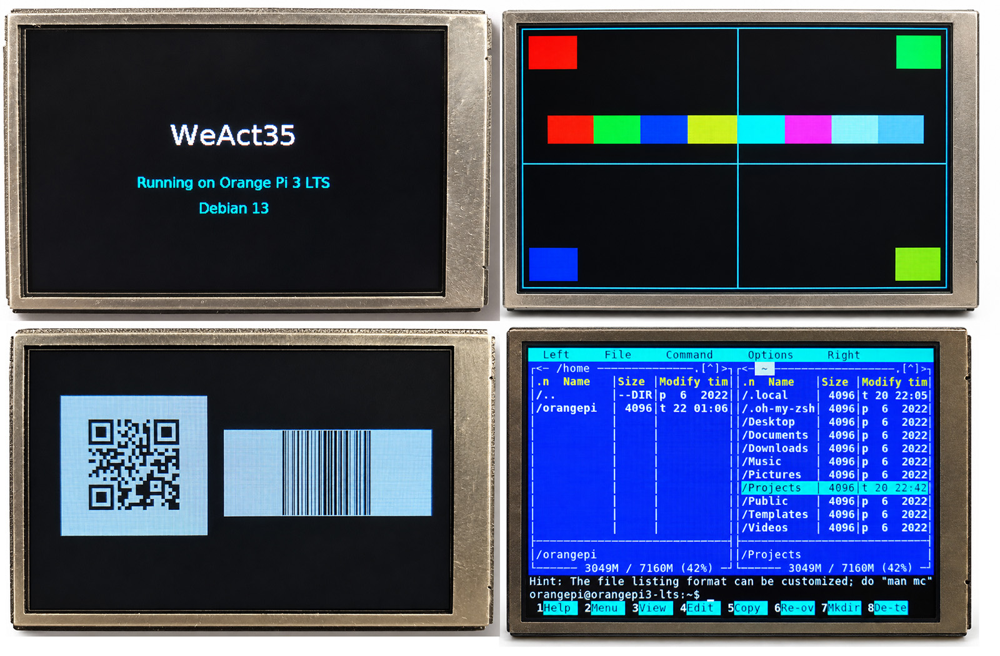

# WeAct35 1.0.0



[English](README.md) | [Русский](README.ru.md)

WeAct35 is a C library and a small Linux command-line toolset for WeAct USB displays. It is for Linux users who want text, images, QR codes, or barcodes, and for C developers who need display graphics and transport.

## Platform and release status

- **ARM64:** Orange Pi 3 LTS, Debian 13; verified packaged revision is `1.0.0-2`.
- **riscv64:** Orange Pi RV2, Ubuntu 24.04.5 LTS; installed and hardware-smoke-tested revision is `1.0.0-3` of upstream `1.0.0`.

RISC-V packages are separate GitHub Release assets with their own `SHA256SUMS`; they are not committed in this source tree. Do not infer an ARM64 `1.0.0-3` release from the RISC-V revision.

## Displays

| Model | USB Product | Geometry | Pixel representation | Practical role |
|---|---|---:|---|---|
| FS35 | `Display FS V1` | 480×320 | RGB565 little-endian | Terminal, text, images, fullscreen and regional codes |
| FS096 | `Display FS 0.96 Inch` | 160×80 | legacy BRG565/MSB | Compact text, images, fullscreen codes |

Both are USB CDC ACM devices with VID:PID `1a86:fe0c`. Programs verify the exact product before writing. FS35 supports preserved rectangular QR/Barcode updates; FS096 deliberately supports codes only fullscreen.

## Included tools

- `libweact.so.1`: C graphics and transport library; the public ABI has 79 exported symbols.
- `weact-cli`: text, UTF-8 file/stdin input, images, scrolling, QR, Code 128, EAN-8, EAN-13, and Code 39.
- `weact-list`: read-only USB inventory; it never opens a serial port.
- `weactterm`: FS35 PTY terminal rendered with libvterm and FreeType. Default mode is a finite memory-only demo; `--run` is hardware mode.

The FS35-only `/init` selects the verified landscape setup and clears the whole screen black. After a power cycle, use `/init` before FS35 regional code updates. Do not run `/init` between separate regions: it clears them.

## Quick start on Debian ARM64

Verify and install the three non-debug packages:

```sh
cd Release/arm64
sha256sum -c SHA256SUMS
sudo apt install ./libweact1_1.0.0_arm64.deb ./libweact-dev_1.0.0_arm64.deb ./weactterm_1.0.0_arm64.deb
```

Discover devices without opening them:

```sh
weact-list --verbose
```

Prefer the stable path under `/dev/serial/by-id/`. The following are hardware commands; run them only after checking the intended device, access rights, and absence of another owner:

```sh
weact-cli /p:/dev/serial/by-id/usb-WeAct_Studio_Display_FS_V1_...-if00 /init
weact-cli /p:/dev/serial/by-id/usb-WeAct_Studio_Display_FS_V1_...-if00 '/qr:https://example.com' /x:40 /y:40 /w:160 /h:160
weact-cli /p:/dev/serial/by-id/usb-WeAct_Studio_Display_FS_V1_...-if00 '/barcode:code128:ABC123' /x:220 /y:80 /w:240 /h:100
```

The two FS35 regions do not overlap. Their white code backgrounds replace only their rectangles; pixels outside are neither read nor transmitted.

## Build from source

```sh
build=$(mktemp -d)
make BUILD_DIR="$build/obj" BIN_DIR="$build/bin" all
LD_LIBRARY_PATH="$build/obj" "$build/bin/weact-cli" /?
```

For Debian binaries use `dpkg-buildpackage -b -us -uc` in this directory when the documented build dependencies are installed.

## Documentation

- [Installation and build](Doc/en/INSTALL.md)
- [CLI and device discovery](Doc/en/CLI.md)
- [Hardware and safe operation](Doc/en/HARDWARE.md)
- [C API reference](Doc/en/API.md)
- [WeActTerm guide](Doc/en/TERMINAL.md)
- [Practical examples](Doc/en/EXAMPLES.md)
- Русская версия: [установка](Doc/ru/INSTALL.md), [CLI](Doc/ru/CLI.md), [оборудование](Doc/ru/HARDWARE.md), [C API](Doc/ru/API.md)
- Русская версия: [терминал](Doc/ru/TERMINAL.md), [примеры](Doc/ru/EXAMPLES.md)

The language directories are the canonical user documentation.
- [RISC-V 1.0.0-3 release notes](Doc/en/RELEASE-1.0.0-3.md)
- [Orange Pi RV2 CDC ACM note](Misc/README.md)

After installing packages, concise English manual pages are available as
`man weact-cli`, `man weact-list`, `man weactterm`, and `man 3 libweact`.
The first three are installed by `weactterm`; the library overview is installed
by `libweact-dev`.

## Verification and limits

The 1.0.0 ARM64 packages passed offline regression and ASan/UBSan checks. Hardware confirmation covers FS35 `/init`, regional Code 128 and QR, plus FS096 fullscreen Code 128 and QR. These are visual confirmations; external scanner reads and byte-for-byte capture of physical LCD pixels are not claimed.

The source bundle contains Expat/MIT, GPL-3.0-only, LGPL-2.1-or-later and BSD-3-Clause notices in `LICENSE` and `LICENSES/`. Public distribution remains subject to project-owner confirmation of GPL adaptation distribution rights.
